## Struktura

Pliki `*_baseline` to programy, które dostaliśmy. Pliki bez sufiksu to poprawki do tych programów.

## Kompilacja
Będąc w folderze `proj1`:
- `make all`: kompilacja
- `make clean`: usuwa skompilowane pliki.

## Uruchamianie
```bash
./src/target/release/latency_baseline <plik> <M>
./src/target/release/latency <plik> <M> <liczba_wątków>
./src/target/release/throughput_baseline <plik> <M>
./src/target/release/throughput <plik> <M>
./src/target/release/pipeline_baseline <plik> <M> <K>
./src/target/release/pipeline <plik> <M> <K>
```

Programy wypisują:
- na `stdout` wynik, czyli hash
- na `stderr` czasy zmierzone przez `std::time::Instant`:
    - `latency*`: `total_s`, `reads`, `avg_read_us`
    - `throughput_baseline`: `total_s`, `read_s`
    - `throughput`: `total_s`
    - `pipeline*`: `total_s`, `read_s`, `compute_s`

## Pomiary
```bash
python3 benchmarks/bench.py                             # plik w cache
python3 benchmarks/bench.py --cold                      # bez cache
python3 benchmarks/bench.py --cold --memory-max 128M    # bez cache + limit pamięci
```
Dla każdej dostępnej konfiguracji generuje plik csv (domyślnie w `benchmarks/results/`).

## Wyniki
```bash
python3 benchmarks/plot.py benchmarks/results/linux
```
Dla każdego pliku csv w podanym katalogu generuje wykresy oraz tabelkę biorąc wiersz z najmniejszym `total_s`.

## Sprzęt

- System: Linux 6.17
- CPU: AMD Ryzen 5 4500U (6 rdzeni, 6 wątków)
- RAM: 14 GiB (+ 2 GiB swap)
- Dysk: Intel SSDPEKNW512G8, NVMe SSD 512 GB

Przepustowość dysku (specyfikacja):
- odczyt 1500 MB/s

## Podsumowanie

Wygenerowane wyniki:
- plik `256 MB`: [summary.md](benchmarks/results/linux/summary.md)
- plik `64 MB` (tylko z flagą `--memory-max 128M`): [summary.md](benchmarks/results/linux/small/summary.md)

Poniżej wstawiam wybrane wykresy z plików `summary.md`, żeby łatwiej czytało się podsumowanie.

Jeśli nie napisano inaczej, po lewej są wykresy z plikiem w cache (warm), a po prawej z odczytem z dysku (cold).

### Latency

<p>
  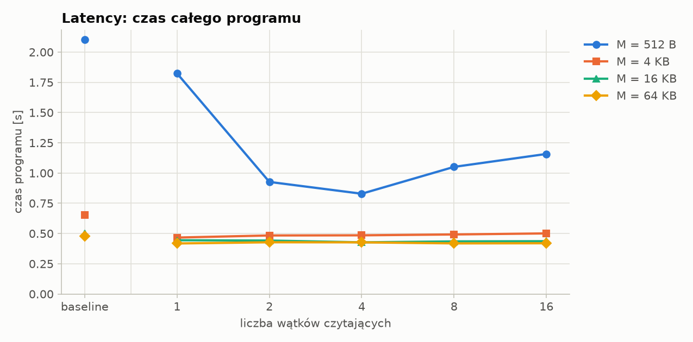
  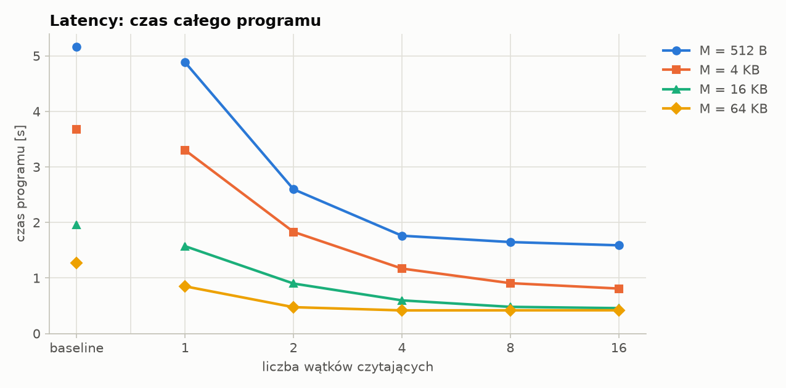
</p>

<p>
  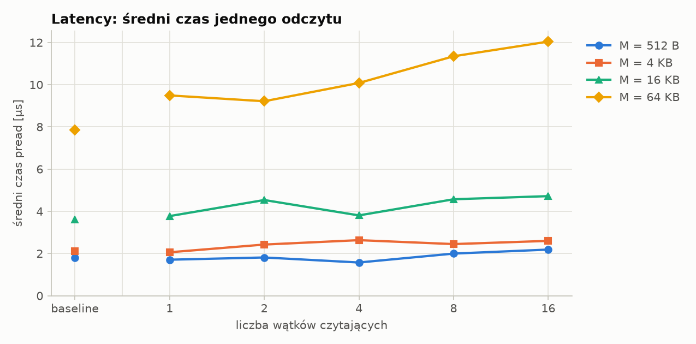
  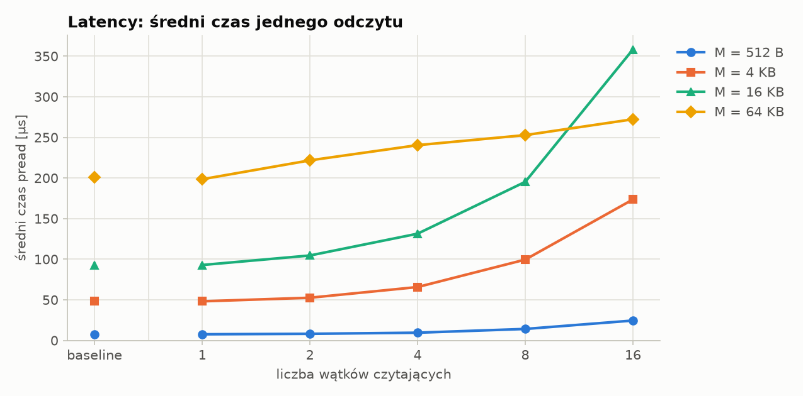
</p>

- Czas działania programu w funkcji M i ilości wątków:

Im większy blok, tym krótszy czas, bo odczytów jest mniej, a każdy odczyt ma stały koszt (syscall, obsługa żądania przez dysk). Dla cold baseline `M = 512 B` mamy `256 MB / 512 B = 524 288` odczytów i czas działania `5.164 s`. Dla `M = 64 KB` mamy `4 096` odczytów i czas działania `1.273 s`.

Już jeden wątek jest szybszy od baseline (np. dla `M = 64 KB`: `1.273 s` -> `0.850 s`), bo odczyt odbywa się równolegle z liczeniem hashu.

- Czy zwiększanie ilości wątków zmniejszy czas wykonania programu?

Tak, ale nie można zejść poniżej czasu samego liczenia hashu w jednym wątku. Więcej wątków przyspiesza program, dopóki konsument czeka na dane. Jeśli wątek liczący ciągle ma dane do liczenia, to dokładanie wątków czytających nie przyspieszy programu, bo wąskim gardłem jest wtedy liczenie hashu.

Potrzebną liczbę wątków można pewnie oszacować jako `liczba bloków x czas odczytu / czas liczenia hashu`.

Dla pliku w cache (warm) odczyty są tanie, więc dla `M >= 4 KB` czas jest prawie stały już od jednego wątku.

- Czy zwiększenie ilości wątków zmniejszy latencję operacji odczytywania danych?

Nie, czas jednego odczytu rośnie wraz ze wzrostem liczby wątków, pomimo że czas całego programu spada. Dysk obsługuje wiele żądań naraz, więc żądania czekają w kolejce i pojedyncze trwa dłużej, ale w sumie dysk obsłuży ich więcej w tym samym czasie.

- Jak wpłynie na latencję posiadanie pliku w pamięci systemu operacyjnego (file cache)?

Plik w file cache wielokrotnie skraca czas pojedynczego odczytu, np. dla `M = 4 KB` z około `48 mikrosekund` (cold) do około `2 mikrosekund` (warm), dla baseline i 1 wątku.

Skoro plik jest w cache, to przy odczycie trzeba go tylko skopiować z RAM, więc czas rośnie z `M`, ale jest o rząd wielkości krótszy niż odczyt z dysku. Przez to wykres czasu programu dla `M = 4, 16, 64 KB` jest prawie płaski: odczyty są tanie, więc czas programu to prawie tyle samo co czas liczenia hashu.

### Throughput

<p>
  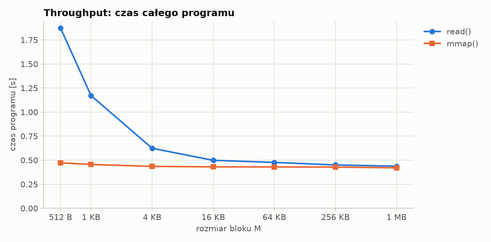
  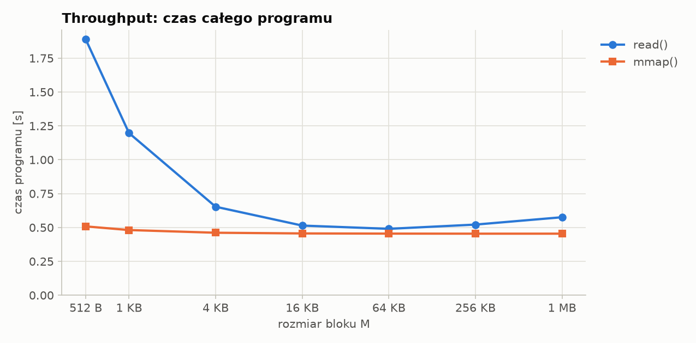
</p>

<p>
  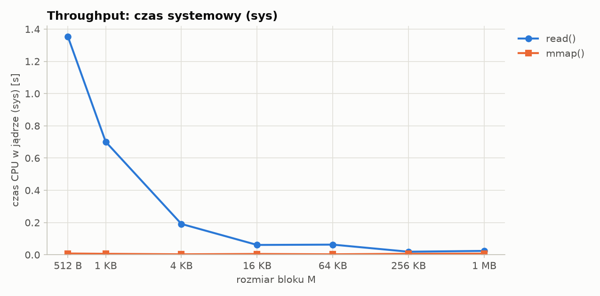
  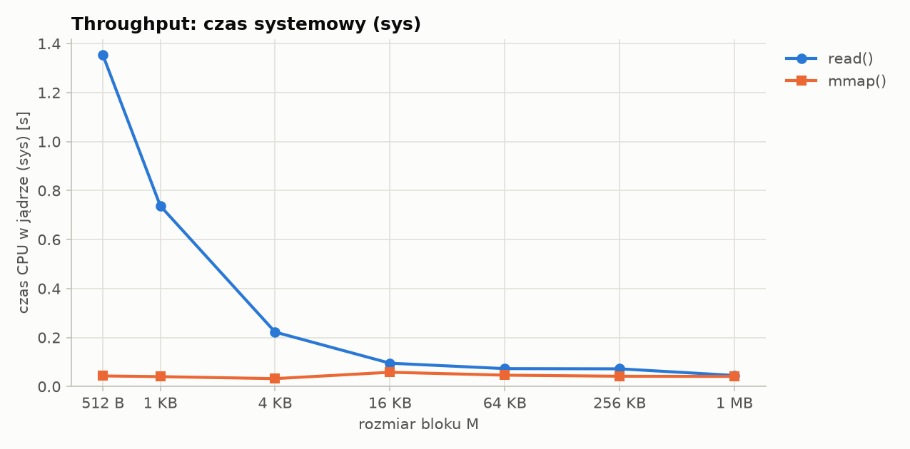
</p>

- Czas działania programu w funkcji M (programu przed poprawką oraz po poprawce):

Czas całego programu po poprawce (mmap) prawie nie zależy od `M` (warm: `0.473 s` dla `512 B`, `0.421 s` dla `1 MB`). Dla programu przed poprawką (read) wraz ze wzrostem `M` czas zbliża się do czasu programu z mmap. Wynika to z tego, że dla małego `M` jest bardzo dużo bloków, a każdy `read` to osobny syscall i kopiowanie danych.
- Czy jest jakiś schemat odczytywania pliku, gdzie mmap zmniejszy obciążenie procesora ponad read?

Tak, czytanie małymi blokami, co widać na wykresie z czasem systemowym. Dla `M = 512 B` wersja z read spędza w jądrze `1.354 s`, a wersja z mmap tylko `0.008 s`. Read robi dużo syscalli (bo jest dużo bloków), a w mmap plik jest mapowany raz i czytany bezpośrednio z pamięci. Przy większym `M` ta różnica zanika (`1 MB`: `0.024 s` vs `0.007 s`), bo wywołań read jest mało.

- Jak wpłynie na latencję posiadanie pliku w pamięci systemu operacyjnego (file cache)?

Posiadanie pliku w file cache ma tutaj mały wpływ. Z dysku czas programu jest dłuższy tylko o kilka procent (np. mmap: `0.42 s` -> `0.45 s`). Moze to wynikać z tego, ze plik czytamy sekwencyjnie, a system moze rozpoznać i wczytuje kolejne fragmenty pliku z wyprzedzeniem.

### Pipeline

<p>
  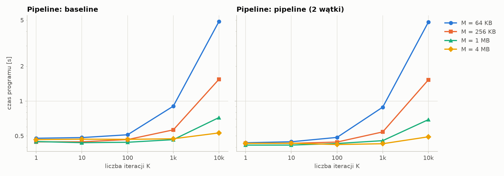
  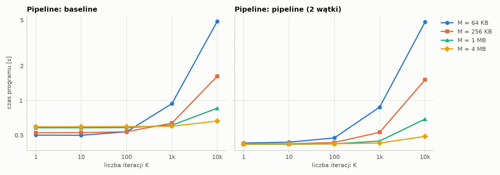
</p>

<p>
  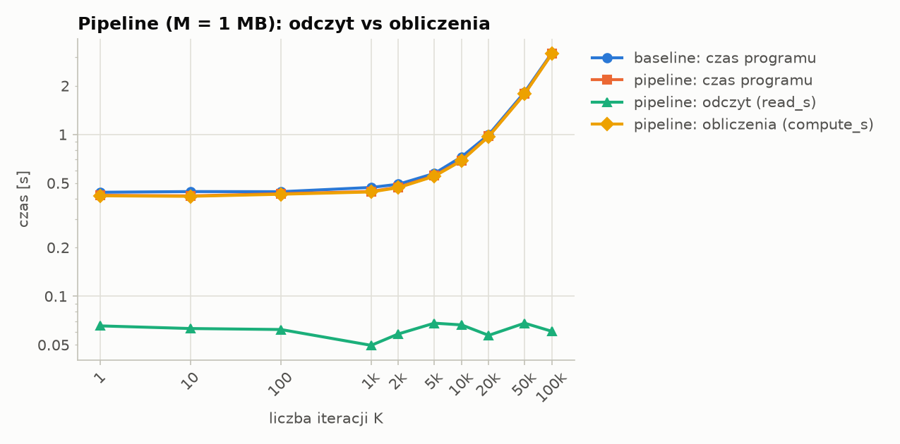
  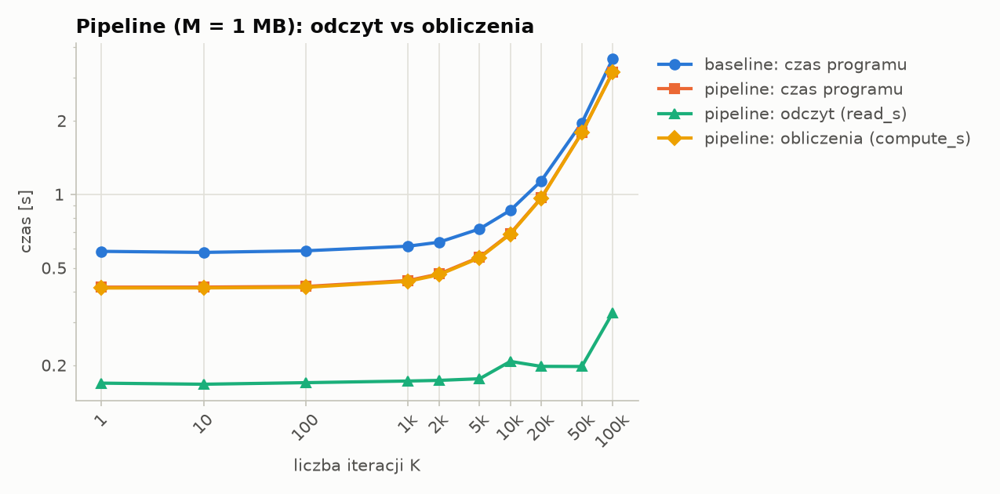
</p>

- Czas działania programu w funkcji M i K:

W baseline czas to `read + compute`. W poprawionym programie z osobnym wątkiem na odczyt czas to `max(read, compute)`. Liczenie hashu jest wolniejsze niż odczyt, więc czas pipeline'u to praktycznie sam czas liczenia, a zysk względem baseline to czas odczytu.

Czas rośnie z `K`, bo każdy blok wykonuje `K` iteracji MD5. Najszybciej rośnie dla małego `M`, bo wtedy jest najwięcej bloków. Dla `K = 10k` i `M = 64 KB` czas to `4.8 s`, a dla `M = 4 MB` tylko `0.49 s`.

- Znajdź `K_opt` dla `M = 1 MB` dla twojego komputera. Rozważ plik w całości mieszczący się w pamięci operacyjnej oraz taki, który należy ciągle transmitować z dysku.

Na sprzęcie, na którym robiłem pomiary, `K_opt` nie istnieje. Już dla `K = 1` z dysku mamy `read_s = 0.169 s` oraz `compute_s = 0.414 s`, czyli liczenie hashu jest wolniejsze od odczytu.

`K_opt` istniałoby dla wolniejszego dysku.

- Czy dodanie większej ilości wątków po stronie czytania lub funkcji hashującej zmieni cokolwiek?

Więcej wątków czytających nic nie da, bo tak jak wcześniej powiedzieliśmy, wąskim gardłem jest liczenie hashu. Tego nie mierzyłem, ale skoro wąskim gardłem jest liczenie hashu, to więcej wątków liczących powinno przyspieszyć program (XOR jest przemienny), aż do momentu, gdy wąskim gardłem stanie się odczyt.

### Presja pamięci

Po lewej odczyt z dysku bez limitu (cold), po prawej z limitem `--memory-max 128M` (plik `256 MB` nie mieści się w limicie).

<p>
  
  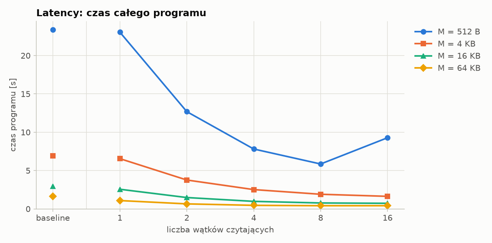
</p>

<p>
  
  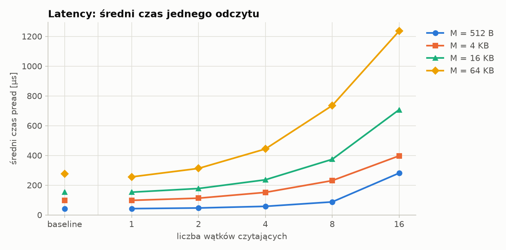
</p>

- Wpływ limitu pamięci (`--memory-max 128M`) na czas działania i latencję:

Limit pamięci mocno spowalnia losowe odczyty: dla `M = 512 B` czas programu rośnie z `5.2 s` do `23.4 s`, a średni czas jednego `pread` z `7.6 mikrosekund` do `42 mikrosekund`. Skoro plik jest większy niż limit, to system musi w trakcie odczytów zwalniać strony, żeby zrobić miejsce na nowe. Przy losowym odczycie zwolnioną stronę często trzeba potem czytać z powrotem.
