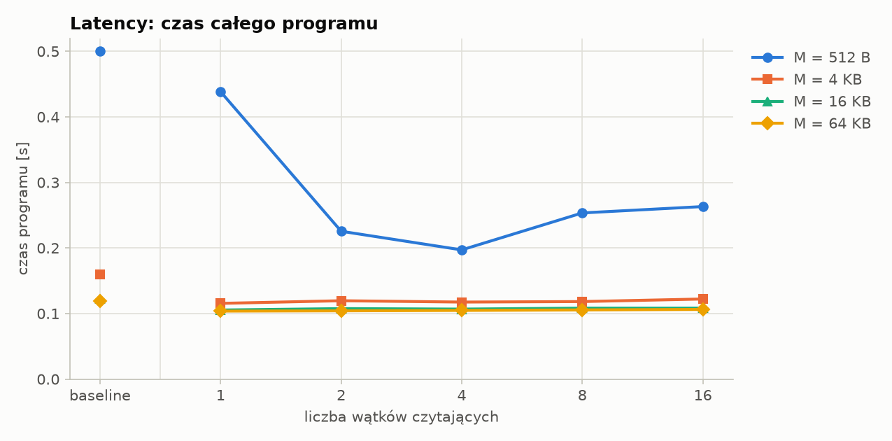
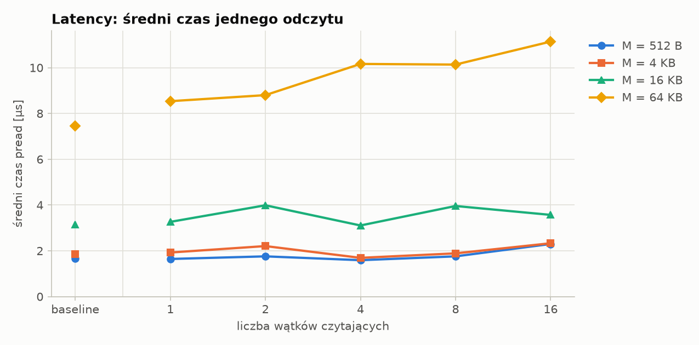
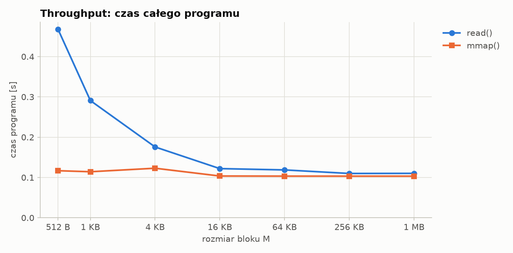
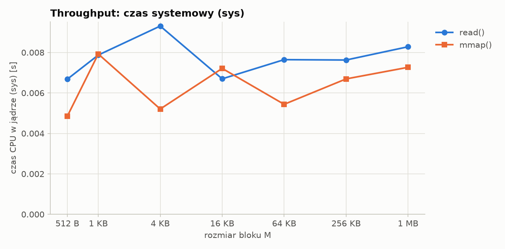
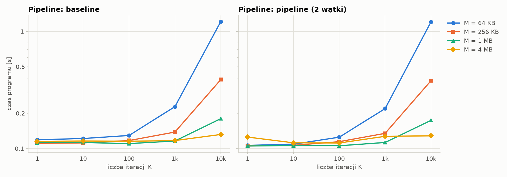
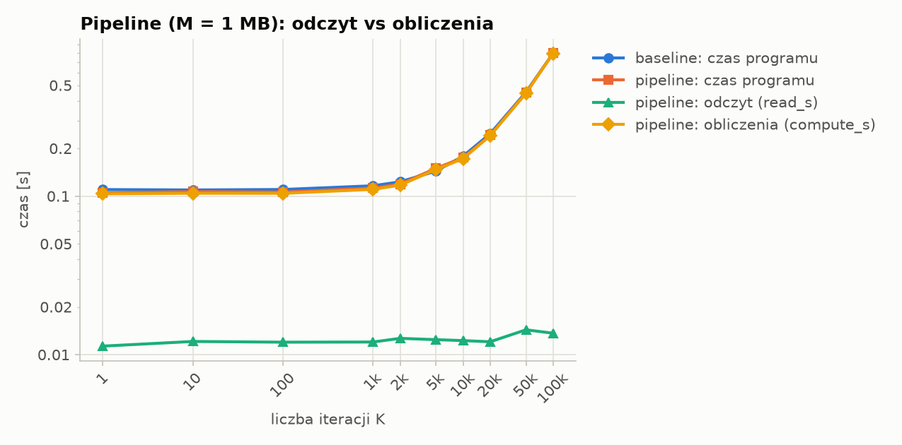

# Wyniki: small

> Wyniki poniżej są generowane automatycznie przez `benchmarks/plot.py` z plików CSV i nadpisywane przy każdym uruchomieniu.

Dla każdej konfiguracji pokazane jest najszybsze z powtórzeń (najmniejszy `total_s`); wszystkie kolumny w wierszu pochodzą z tego samego uruchomienia.

## Tryb: warm_mem128M

```
date: 2026-10-18 15:32:35
platform: Linux-6.17.0-14-generic-x86_64-with-glibc2.39
cpu_count: 6
file: /home/filip/Pulpit/studia/ISBD-MIMUW/projects/proj1/benchmarks/files/small.bin
file_size_bytes: 67108864
cold: False
memory_max: 128M
repeats: 5
```

### Latency

**Czas całego programu [s]**

| M | baseline | 1 wątk. | 2 wątk. | 4 wątk. | 8 wątk. | 16 wątk. |
|---:|---:|---:|---:|---:|---:|---:|
| 512 B | 0.500 | 0.438 | 0.226 | 0.197 | 0.253 | 0.263 |
| 4 KB | 0.160 | 0.116 | 0.120 | 0.118 | 0.118 | 0.122 |
| 16 KB | 0.122 | 0.105 | 0.108 | 0.107 | 0.108 | 0.108 |
| 64 KB | 0.119 | 0.104 | 0.104 | 0.105 | 0.106 | 0.106 |

**Średni czas jednego pread [µs]**

| M | baseline | 1 wątk. | 2 wątk. | 4 wątk. | 8 wątk. | 16 wątk. |
|---:|---:|---:|---:|---:|---:|---:|
| 512 B | 1.67 | 1.64 | 1.76 | 1.59 | 1.76 | 2.30 |
| 4 KB | 1.86 | 1.93 | 2.21 | 1.69 | 1.89 | 2.33 |
| 16 KB | 3.15 | 3.26 | 3.99 | 3.11 | 3.96 | 3.57 |
| 64 KB | 7.45 | 8.54 | 8.80 | 10.16 | 10.13 | 11.14 |





### Throughput

| M | read: czas [s] | mmap: czas [s] | read: sys [s] | mmap: sys [s] | read: same odczyty [s] |
|---:|---:|---:|---:|---:|---:|
| 512 B | 0.468 | 0.117 | 0.007 | 0.005 | 0.193 |
| 1 KB | 0.291 | 0.114 | 0.008 | 0.008 | 0.101 |
| 4 KB | 0.176 | 0.123 | 0.009 | 0.005 | 0.031 |
| 16 KB | 0.122 | 0.104 | 0.007 | 0.007 | 0.013 |
| 64 KB | 0.119 | 0.103 | 0.008 | 0.005 | 0.008 |
| 256 KB | 0.110 | 0.103 | 0.008 | 0.007 | 0.006 |
| 1 MB | 0.110 | 0.103 | 0.008 | 0.007 | 0.006 |





### Pipeline: siatka M × K

**Czas programu [s]: baseline → pipeline**

| K | M = 64 KB | M = 256 KB | M = 1 MB | M = 4 MB |
|---:|---:|---:|---:|---:|
| 1 | 0.119 → 0.106 | 0.111 → 0.105 | 0.112 → 0.105 | 0.115 → 0.125 |
| 10 | 0.122 → 0.109 | 0.112 → 0.107 | 0.113 → 0.106 | 0.116 → 0.112 |
| 100 | 0.129 → 0.125 | 0.117 → 0.114 | 0.110 → 0.106 | 0.115 → 0.112 |
| 1k | 0.228 → 0.219 | 0.138 → 0.135 | 0.116 → 0.113 | 0.117 → 0.127 |
| 10k | 1.214 → 1.207 | 0.388 → 0.380 | 0.180 → 0.174 | 0.132 → 0.128 |



### Pipeline: M = 1 MB, przemiatanie K

| K | baseline: czas [s] | pipeline: czas [s] | pipeline: read_s | pipeline: compute_s |
|---:|---:|---:|---:|---:|
| 1 | 0.110 | 0.105 | 0.011 | 0.103 |
| 10 | 0.109 | 0.107 | 0.012 | 0.104 |
| 100 | 0.110 | 0.106 | 0.012 | 0.104 |
| 1k | 0.116 | 0.112 | 0.012 | 0.110 |
| 2k | 0.123 | 0.119 | 0.013 | 0.117 |
| 5k | 0.144 | 0.150 | 0.012 | 0.147 |
| 10k | 0.179 | 0.175 | 0.012 | 0.172 |
| 20k | 0.247 | 0.242 | 0.012 | 0.240 |
| 50k | 0.453 | 0.448 | 0.014 | 0.446 |
| 100k | 0.797 | 0.798 | 0.014 | 0.795 |



---

<!-- Wszystko poniżej tej linii plot.py zachowuje przy ponownym generowaniu. -->

## Podsumowanie

_Tu wpisz własne wnioski._
