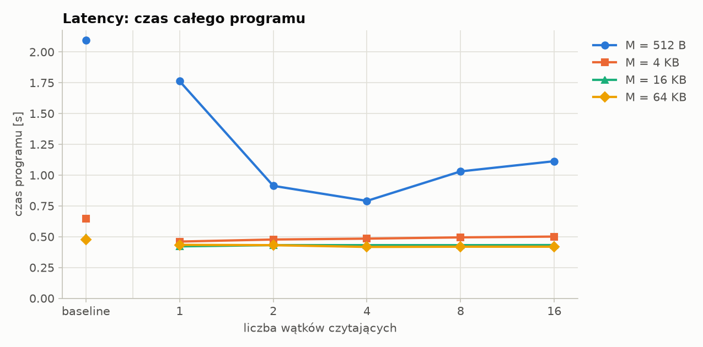
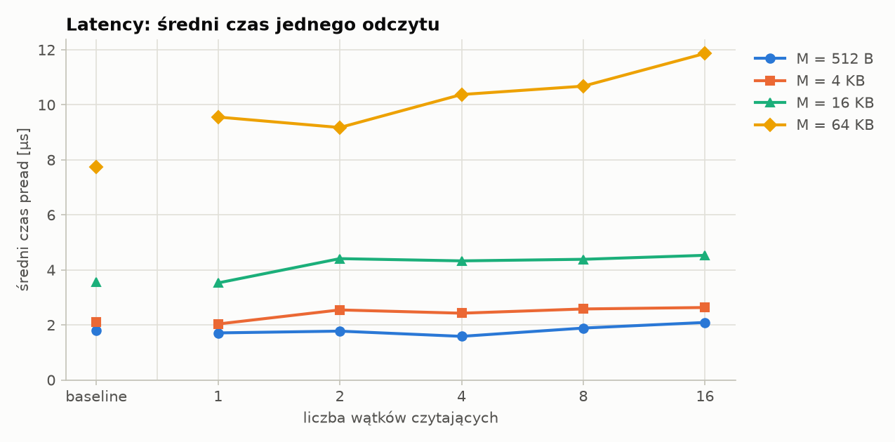
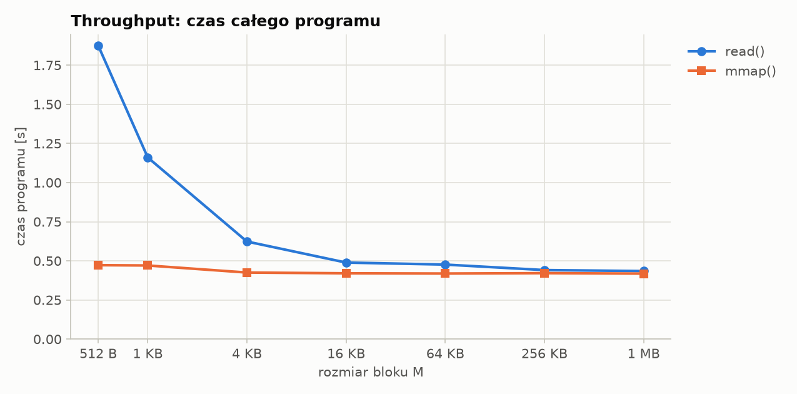
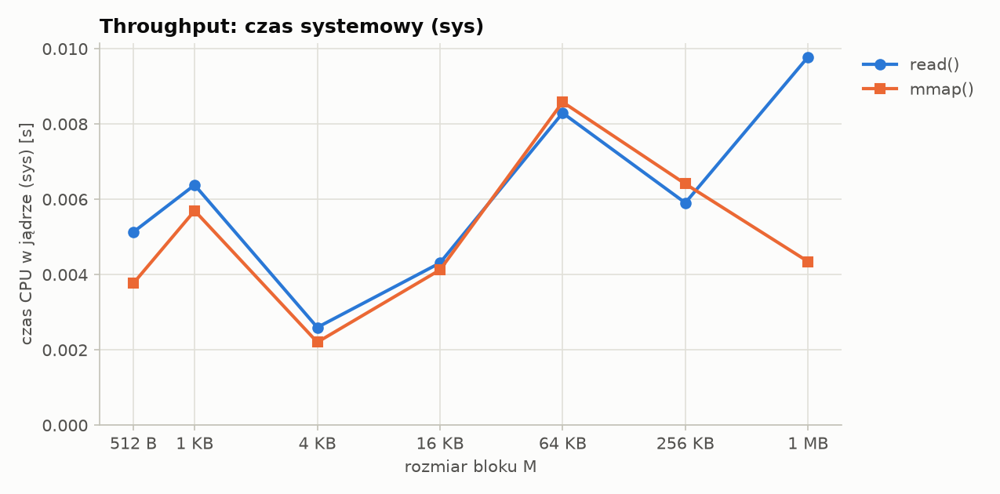
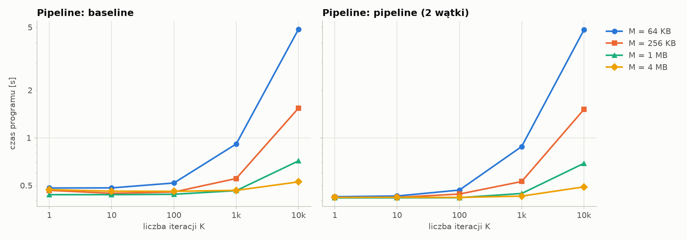
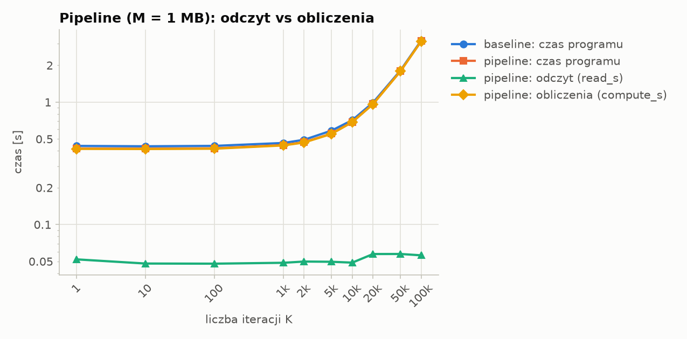

# Wyniki: linux

> Wyniki poniżej są generowane automatycznie przez `benchmarks/plot.py` z plików CSV i nadpisywane przy każdym uruchomieniu.

Dla każdej konfiguracji pokazane jest najszybsze z powtórzeń (najmniejszy `total_s`); wszystkie kolumny w wierszu pochodzą z tego samego uruchomienia.

## Tryb: cold

```
date: 2026-10-18 15:15:36
platform: Linux-6.17.0-14-generic-x86_64-with-glibc2.39
cpu_count: 6
file: /home/filip/Pulpit/studia/ISBD-MIMUW/projects/proj1/benchmarks/files/test.bin
file_size_bytes: 268435456
cold: True
memory_max: None
repeats: 5
```

### Latency

**Czas całego programu [s]**

| M | baseline | 1 wątk. | 2 wątk. | 4 wątk. | 8 wątk. | 16 wątk. |
|---:|---:|---:|---:|---:|---:|---:|
| 512 B | 5.164 | 4.883 | 2.598 | 1.761 | 1.647 | 1.589 |
| 4 KB | 3.682 | 3.301 | 1.831 | 1.170 | 0.907 | 0.810 |
| 16 KB | 1.955 | 1.573 | 0.900 | 0.597 | 0.481 | 0.457 |
| 64 KB | 1.273 | 0.850 | 0.475 | 0.417 | 0.418 | 0.419 |

**Średni czas jednego pread [µs]**

| M | baseline | 1 wątk. | 2 wątk. | 4 wątk. | 8 wątk. | 16 wątk. |
|---:|---:|---:|---:|---:|---:|---:|
| 512 B | 7.63 | 7.54 | 8.15 | 9.50 | 14.12 | 24.46 |
| 4 KB | 48.17 | 48.12 | 52.55 | 65.71 | 99.50 | 173.56 |
| 16 KB | 92.23 | 92.86 | 104.56 | 131.39 | 195.24 | 358.28 |
| 64 KB | 201.05 | 198.48 | 221.70 | 240.42 | 252.78 | 272.29 |


### Throughput

| M | read: czas [s] | mmap: czas [s] | read: sys [s] | mmap: sys [s] | read: same odczyty [s] |
|---:|---:|---:|---:|---:|---:|
| 512 B | 1.888 | 0.508 | 1.353 | 0.043 | 0.802 |
| 1 KB | 1.197 | 0.481 | 0.737 | 0.040 | 0.435 |
| 4 KB | 0.653 | 0.461 | 0.222 | 0.032 | 0.143 |
| 16 KB | 0.514 | 0.456 | 0.095 | 0.058 | 0.074 |
| 64 KB | 0.490 | 0.455 | 0.073 | 0.046 | 0.053 |
| 256 KB | 0.521 | 0.454 | 0.072 | 0.042 | 0.101 |
| 1 MB | 0.576 | 0.454 | 0.045 | 0.041 | 0.160 |


### Pipeline: siatka M × K

**Czas programu [s]: baseline → pipeline**

| K | M = 64 KB | M = 256 KB | M = 1 MB | M = 4 MB |
|---:|---:|---:|---:|---:|
| 1 | 0.501 → 0.428 | 0.525 → 0.421 | 0.580 → 0.417 | 0.592 → 0.419 |
| 10 | 0.499 → 0.435 | 0.527 → 0.422 | 0.580 → 0.417 | 0.592 → 0.420 |
| 100 | 0.535 → 0.474 | 0.536 → 0.432 | 0.582 → 0.420 | 0.594 → 0.421 |
| 1k | 0.940 → 0.878 | 0.636 → 0.530 | 0.610 → 0.445 | 0.599 → 0.427 |
| 10k | 4.885 → 4.813 | 1.626 → 1.514 | 0.858 → 0.691 | 0.663 → 0.488 |


### Pipeline: M = 1 MB, przemiatanie K

| K | baseline: czas [s] | pipeline: czas [s] | pipeline: read_s | pipeline: compute_s |
|---:|---:|---:|---:|---:|
| 1 | 0.584 | 0.417 | 0.169 | 0.414 |
| 10 | 0.578 | 0.417 | 0.167 | 0.414 |
| 100 | 0.587 | 0.420 | 0.170 | 0.416 |
| 1k | 0.613 | 0.444 | 0.172 | 0.441 |
| 2k | 0.637 | 0.472 | 0.173 | 0.468 |
| 5k | 0.722 | 0.553 | 0.176 | 0.550 |
| 10k | 0.860 | 0.691 | 0.207 | 0.687 |
| 20k | 1.134 | 0.966 | 0.198 | 0.962 |
| 50k | 1.960 | 1.787 | 0.198 | 1.783 |
| 100k | 3.576 | 3.154 | 0.327 | 3.150 |


## Tryb: warm

```
date: 2026-10-18 15:34:53
platform: Linux-6.17.0-14-generic-x86_64-with-glibc2.39
cpu_count: 6
file: /home/filip/Pulpit/studia/ISBD-MIMUW/projects/proj1/benchmarks/files/test.bin
file_size_bytes: 268435456
cold: False
memory_max: None
repeats: 5
```

### Latency

**Czas całego programu [s]**

| M | baseline | 1 wątk. | 2 wątk. | 4 wątk. | 8 wątk. | 16 wątk. |
|---:|---:|---:|---:|---:|---:|---:|
| 512 B | 2.102 | 1.824 | 0.927 | 0.829 | 1.051 | 1.158 |
| 4 KB | 0.654 | 0.467 | 0.484 | 0.485 | 0.492 | 0.501 |
| 16 KB | 0.502 | 0.444 | 0.442 | 0.427 | 0.435 | 0.437 |
| 64 KB | 0.477 | 0.418 | 0.428 | 0.427 | 0.419 | 0.420 |

**Średni czas jednego pread [µs]**

| M | baseline | 1 wątk. | 2 wątk. | 4 wątk. | 8 wątk. | 16 wątk. |
|---:|---:|---:|---:|---:|---:|---:|
| 512 B | 1.81 | 1.71 | 1.81 | 1.57 | 2.00 | 2.19 |
| 4 KB | 2.12 | 2.06 | 2.42 | 2.63 | 2.45 | 2.60 |
| 16 KB | 3.61 | 3.77 | 4.53 | 3.81 | 4.57 | 4.72 |
| 64 KB | 7.85 | 9.49 | 9.21 | 10.08 | 11.34 | 12.04 |


### Throughput

| M | read: czas [s] | mmap: czas [s] | read: sys [s] | mmap: sys [s] | read: same odczyty [s] |
|---:|---:|---:|---:|---:|---:|
| 512 B | 1.875 | 0.473 | 1.354 | 0.008 | 0.772 |
| 1 KB | 1.172 | 0.456 | 0.701 | 0.006 | 0.408 |
| 4 KB | 0.624 | 0.436 | 0.191 | 0.003 | 0.120 |
| 16 KB | 0.499 | 0.431 | 0.061 | 0.005 | 0.054 |
| 64 KB | 0.477 | 0.430 | 0.063 | 0.003 | 0.032 |
| 256 KB | 0.451 | 0.429 | 0.019 | 0.006 | 0.023 |
| 1 MB | 0.438 | 0.421 | 0.024 | 0.007 | 0.022 |


### Pipeline: siatka M × K

**Czas programu [s]: baseline → pipeline**

| K | M = 64 KB | M = 256 KB | M = 1 MB | M = 4 MB |
|---:|---:|---:|---:|---:|
| 1 | 0.477 → 0.436 | 0.444 → 0.431 | 0.447 → 0.416 | 0.464 → 0.431 |
| 10 | 0.483 → 0.445 | 0.444 → 0.431 | 0.437 → 0.416 | 0.468 → 0.432 |
| 100 | 0.511 → 0.485 | 0.465 → 0.442 | 0.440 → 0.430 | 0.467 → 0.421 |
| 1k | 0.903 → 0.885 | 0.563 → 0.541 | 0.464 → 0.455 | 0.472 → 0.428 |
| 10k | 4.868 → 4.813 | 1.542 → 1.525 | 0.720 → 0.691 | 0.530 → 0.491 |


### Pipeline: M = 1 MB, przemiatanie K

| K | baseline: czas [s] | pipeline: czas [s] | pipeline: read_s | pipeline: compute_s |
|---:|---:|---:|---:|---:|
| 1 | 0.439 | 0.420 | 0.066 | 0.417 |
| 10 | 0.443 | 0.417 | 0.063 | 0.414 |
| 100 | 0.443 | 0.430 | 0.062 | 0.427 |
| 1k | 0.470 | 0.444 | 0.050 | 0.441 |
| 2k | 0.492 | 0.472 | 0.058 | 0.469 |
| 5k | 0.574 | 0.555 | 0.068 | 0.551 |
| 10k | 0.726 | 0.691 | 0.066 | 0.687 |
| 20k | 0.996 | 0.974 | 0.057 | 0.972 |
| 50k | 1.826 | 1.786 | 0.068 | 1.782 |
| 100k | 3.188 | 3.152 | 0.061 | 3.149 |


## Tryb: warm_mem128M

```
date: 2026-10-18 15:24:46
platform: Linux-6.17.0-14-generic-x86_64-with-glibc2.39
cpu_count: 6
file: /home/filip/Pulpit/studia/ISBD-MIMUW/projects/proj1/benchmarks/files/test.bin
file_size_bytes: 268435456
cold: False
memory_max: 128M
repeats: 5
```

### Latency

**Czas całego programu [s]**

| M | baseline | 1 wątk. | 2 wątk. | 4 wątk. | 8 wątk. | 16 wątk. |
|---:|---:|---:|---:|---:|---:|---:|
| 512 B | 2.094 | 1.762 | 0.913 | 0.791 | 1.030 | 1.113 |
| 4 KB | 0.646 | 0.460 | 0.477 | 0.484 | 0.495 | 0.501 |
| 16 KB | 0.494 | 0.422 | 0.432 | 0.431 | 0.431 | 0.432 |
| 64 KB | 0.477 | 0.434 | 0.431 | 0.417 | 0.419 | 0.419 |

**Średni czas jednego pread [µs]**

| M | baseline | 1 wątk. | 2 wątk. | 4 wątk. | 8 wątk. | 16 wątk. |
|---:|---:|---:|---:|---:|---:|---:|
| 512 B | 1.80 | 1.71 | 1.77 | 1.58 | 1.89 | 2.09 |
| 4 KB | 2.11 | 2.03 | 2.55 | 2.43 | 2.58 | 2.63 |
| 16 KB | 3.57 | 3.53 | 4.41 | 4.33 | 4.38 | 4.53 |
| 64 KB | 7.75 | 9.55 | 9.17 | 10.37 | 10.68 | 11.87 |





### Throughput

| M | read: czas [s] | mmap: czas [s] | read: sys [s] | mmap: sys [s] | read: same odczyty [s] |
|---:|---:|---:|---:|---:|---:|
| 512 B | 1.876 | 0.472 | 0.005 | 0.004 | 0.773 |
| 1 KB | 1.160 | 0.470 | 0.006 | 0.006 | 0.404 |
| 4 KB | 0.623 | 0.425 | 0.003 | 0.002 | 0.119 |
| 16 KB | 0.489 | 0.420 | 0.004 | 0.004 | 0.054 |
| 64 KB | 0.476 | 0.419 | 0.008 | 0.009 | 0.031 |
| 256 KB | 0.441 | 0.421 | 0.006 | 0.006 | 0.022 |
| 1 MB | 0.435 | 0.418 | 0.010 | 0.004 | 0.021 |





### Pipeline: siatka M × K

**Czas programu [s]: baseline → pipeline**

| K | M = 64 KB | M = 256 KB | M = 1 MB | M = 4 MB |
|---:|---:|---:|---:|---:|
| 1 | 0.481 → 0.424 | 0.465 → 0.419 | 0.437 → 0.417 | 0.470 → 0.420 |
| 10 | 0.482 → 0.429 | 0.446 → 0.420 | 0.437 → 0.417 | 0.460 → 0.421 |
| 100 | 0.518 → 0.467 | 0.454 → 0.441 | 0.439 → 0.418 | 0.459 → 0.420 |
| 1k | 0.914 → 0.881 | 0.553 → 0.529 | 0.463 → 0.445 | 0.465 → 0.428 |
| 10k | 4.858 → 4.812 | 1.539 → 1.513 | 0.714 → 0.690 | 0.526 → 0.489 |



### Pipeline: M = 1 MB, przemiatanie K

| K | baseline: czas [s] | pipeline: czas [s] | pipeline: read_s | pipeline: compute_s |
|---:|---:|---:|---:|---:|
| 1 | 0.439 | 0.418 | 0.052 | 0.415 |
| 10 | 0.436 | 0.417 | 0.048 | 0.414 |
| 100 | 0.439 | 0.419 | 0.048 | 0.417 |
| 1k | 0.464 | 0.446 | 0.049 | 0.443 |
| 2k | 0.493 | 0.471 | 0.050 | 0.468 |
| 5k | 0.585 | 0.553 | 0.050 | 0.550 |
| 10k | 0.712 | 0.690 | 0.049 | 0.687 |
| 20k | 0.991 | 0.967 | 0.057 | 0.964 |
| 50k | 1.815 | 1.792 | 0.057 | 1.789 |
| 100k | 3.190 | 3.152 | 0.056 | 3.149 |



---

<!-- Wszystko poniżej tej linii plot.py zachowuje przy ponownym generowaniu. -->

## Podsumowanie

_Tu wpisz własne wnioski._
